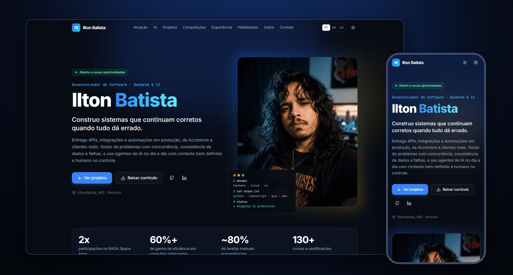

<div align="center">

# Ilton Batista · Portfólio

**Desenvolvedor de Software · Backend & IA**

[](https://iltonbjsilva.github.io/)
[](https://github.com/IltonBJSilva/IltonBJSilva.github.io/actions/workflows/deploy.yml)


<a href="https://iltonbjsilva.github.io/"></a>

</div>

---

## Sobre

Portfólio pessoal com uma regra simples: **nada entra sem prova**. Cada área de atuação aponta para um projeto
real no GitHub ou para um resultado medido em empresa, e cada projeto mostra o que foi feito, como e com quais
números.

## O que tem no site

| Seção | Conteúdo |
|---|---|
| **Início** | Apresentação, currículo para download no idioma escolhido e números de impacto |
| **Atuação** | Arquitetura, IA, Dados & ML, Segurança, DevOps e Automação, cada uma ligada aos projetos que a comprovam |
| **IA aplicada** | Fluxo de trabalho com agentes de IA em 5 etapas, cada uma com evidência, e conteúdo publicado no LinkedIn |
| **Projetos** | Projetos em destaque com destaques técnicos, métricas e stack, filtráveis por área |
| **Competições** | NASA Space Apps Challenge 2025 e 2026, com contribuições, links oficiais e certificados |
| **Experiência** | Linha do tempo profissional |
| **Habilidades** | Stack agrupada por área |
| **Sobre e Contato** | Formação, certificações, idiomas e formas de contato |

## Destaques técnicos

- **Projetos sem mexer no código**: repositórios com o tópico `portfolio` no GitHub entram no site automaticamente,
  pela API do GitHub ([como fazer](#como-adicionar-um-projeto)).
- **Três idiomas com tipagem**: PT, EN e ES seguem a mesma interface (`Translation`); faltar um texto é erro de
  compilação. O idioma vem do navegador e o `lang` da página acompanha a escolha.
- **Tema claro e escuro sem "piscar"**: o tema é aplicado por um script no `<head>`, antes da renderização.
- **Leve**: foto em WebP (306 KB → 55 KB), fontes com `display=swap` e JavaScript de ~80 KB (gzip).
- **Acessível**: navegação por teclado, link para pular ao conteúdo, `aria-*` nos controles e animações que
  respeitam `prefers-reduced-motion`.
- **Pronto para compartilhar**: Open Graph com imagem própria (prévia no LinkedIn e WhatsApp), favicon e dados
  estruturados `Person` (JSON-LD).
- **Qualidade no CI**: lint, typecheck e build a cada push e pull request; deploy automático na `master`.

## Rodar localmente

Requer Node.js 20 ou superior.

```bash
npm install
npm run dev        # http://localhost:5173
npm run build      # typecheck + build de produção em dist/
npm run lint
npm run preview    # serve o build localmente
```

## Como adicionar um projeto

### Opção 1: sem código (pelo GitHub)

1. Abra o repositório no GitHub e clique na engrenagem ⚙️ ao lado de **About**.
2. Em **Topics**, adicione `portfolio`.
3. Preencha a **Description** (vira o texto do card) e, se houver, o **Website** (vira o botão "Ver online").
4. Para definir a área no filtro, adicione um destes tópicos:

   | Tópico | Área no site |
   |---|---|
   | `architecture`, `distributed-systems`, `microservices` | Arquitetura |
   | `ai`, `llm`, `agents`, `ai-agents` | IA & LLMs |
   | `machine-learning`, `ml`, `data`, `data-science` | Dados & ML |
   | `security` | Segurança |
   | `devops`, `docker`, `ci-cd` | DevOps |
   | `automation`, `bot` | Automação |

   Os demais tópicos (ex.: `fastapi`, `postgresql`) aparecem como tecnologias.

O projeto aparece sem novo deploy (os dados ficam em cache por até 1 hora em cada visitante). Para tirá-lo do site,
remova o tópico `portfolio`.

### Opção 2: card completo (pelo código)

Para um card com destaques, métricas e textos nos 3 idiomas, edite `src/data/projects.ts`. Dá para fazer direto
pelo editor web do GitHub (tecla `.` no repositório); o deploy roda sozinho a cada push na `master`.

## Onde editar o conteúdo

| O quê | Arquivo |
|---|---|
| Textos do site, experiência, habilidades e formação | `src/data/translations/{pt,en,es}.ts` |
| Projetos em destaque e lista de projetos anteriores | `src/data/projects.ts` |
| Hackathons e competições | `src/data/competitions.ts` |
| Links, e-mail e currículos | `src/data/profile.ts` e `src/docs/` |
| Certificados (PDF) | `public/certificates/` |

## Deploy

O workflow [`deploy.yml`](.github/workflows/deploy.yml) roda lint e build em todo push e pull request. Na `master`,
publica o `dist/` no GitHub Pages pelo GitHub Actions.

## Estrutura

```
src/
  components/
    layout/               Header (menu, idioma, tema) e Footer
    sections/             Hero, FocusAreas, AiSection, Projects, Competitions,
                          Experience, Skills, About, Contact
    ui/                   Button, Reveal (animação ao rolar), SectionHeader
  context/                idioma (LanguageProvider + useLanguage)
  data/                   conteúdo: projetos, competições, perfil e traduções
  hooks/                  useProjects (GitHub), useTheme, useActiveSection
  types/                  tipos do conteúdo e das traduções
public/                   favicon, imagem de compartilhamento e certificados
docs/                     imagens do README
.github/workflows/        CI e deploy no GitHub Pages
```

## Contato

[](https://www.linkedin.com/in/iltonbsilva/)
[](https://github.com/IltonBJSilva)
[](mailto:iltonbatista2018@gmail.com)
